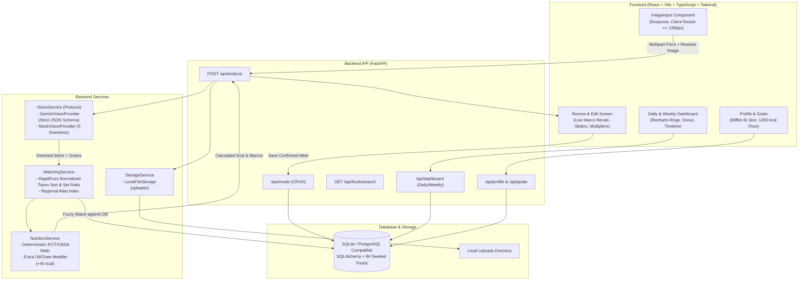

# NutriLens — AI-Powered Visual Nutrition & Calorie Tracker

NutriLens is an AI-assisted calorie and nutrition tracking platform. In **Phase 1 (Testing Build)**, users upload meal photos from their device (file picker or drag-and-drop). The AI vision pipeline segments each distinct dish on the plate, estimates portions in grams, and matches them to a deterministic nutrition engine backed by **IFCT 2017 & USDA FoodData Central**.

---

## 🏛️ Architecture Overview



---

## 🚀 Quickstart (Running Locally)

### Prerequisites
- Python 3.10+
- Node.js 18+

### 1. Backend Setup
```powershell
cd z:\xz\backend
python -m venv venv
.\venv\Scripts\activate
pip install -r requirements.txt

# Run database seeder (seeds 84 foods + default user/goals)
python -m app.seed.seed_data

# Start backend server on http://localhost:8000
uvicorn app.main:app --reload --host 0.0.0.0 --port 8000
```

### 2. Frontend Setup
```powershell
cd z:\xz\frontend
npm install
npm run dev
```
Open **http://localhost:5173** in your browser.

---

## ⚙️ Configuration & Vision Recognition

NutriLens supports two vision recognition modes:

### 1. Real AI Vision with Gemini (Recommended for Any Meal Photo)
NutriLens connects to **Google Gemini 2.5 Flash** to visually analyze the raw pixels of ANY uploaded meal photo, accurately recognizing every separate food on the plate (e.g. Pizza, Dosa, Chapati, Chicken Curry, Biryani, Pasta, Noodles, Salads):
- **Option A (Via Web UI)**: Click the **"Connect Gemini Key"** badge in the top navigation bar, paste your free Gemini API key, and click **"Activate Real AI Vision"**.
- **Option B (Via .env)**: In `backend/.env`, set:
  ```env
  VISION_PROVIDER=gemini
  GEMINI_API_KEY=your_gemini_api_key_here
  ```
Get a free Gemini API key at: [Google AI Studio](https://aistudio.google.com/apikey).

### 2. Smart Mock Mode (100% Offline Testing)
If running without an API key, NutriLens does not blindly force the same dishes. It utilizes:
- **Visual Color & Texture Heuristics**: Analyzes dominant RGB channels (e.g., golden-yellow $\to$ Biryani/Fried, red/orange $\to$ Curries, white $\to$ Idli/Rice, green $\to$ Fresh Salads).
- **Meal Hint Presets**: In the upload modal, you can select quick presets (e.g. *Dosa Combo, Biryani Platter, Roti & Paneer Curry, Burger & Fries, Healthy Salad*) or type any custom dish name.
- **Review & Search**: On the review screen, tap the search icon on any dish to switch it to any of the 84 verified database foods with live calorie recalculation.

---

## 🧪 5 Test Scenarios & Sample Images

Sample images with clear visual representations are provided in `backend/test_images/`:

| Scenario File | Description | Detection Results |
|---|---|---|
| `thali_plate.jpg` | Traditional South Indian Thali | Rice (150g), Sambar (120g), Rasam (100g), Cabbage Poriyal (80g), Curd (100g), Papad (15g) |
| `idli_vada_plate.jpg` | South Indian Breakfast | Idli (160g, 2 pcs), Medu Vada (50g, 1 pc), Sambar (100g), Coconut Chutney (40g) |
| `chicken_biryani.jpg` | Biryani Platter | Chicken Biryani (250g), Boondi Raita (80g), Boiled Egg (50g) |
| `burger_and_fries.jpg` | Fast Food Combo | Chicken Burger (180g), French Fries (100g) |
| `empty_plate.jpg` | Non-food / Empty Plate | `is_food=False` with guidance feedback to center meal |

---

## 🛡️ Medical Disclaimer & Guardrails
- **Honesty Note**: *"Calorie values are estimates from photos and may be off by 10-20%. Edit items for better accuracy."*
- **Safety Guardrail**: Mifflin-St Jeor daily calorie targets are strictly floored at **1,200 kcal/day**. Any calculated deficit lower than 1,200 is clamped and accompanied by clinical advisory to consult a healthcare professional.

---

## 🐳 Docker Deployment
```bash
docker-compose up --build
```
Access the application at `http://localhost:5173`.
